# Build an Agent to Handle Demand Spikes

## Prerequisites

- Access to **Joule Studio**
- Access to an **SAP S/4HANA Cloud** system with the standard demo data


## You will learn

- How to write an effective **intent statement** for an agent
- How to review and validate the assets created, including the generated **Product Requirements Document (PRD)**
- How to deploy a production-ready Joule Agent to the SAP managed service


## Intro

>**IMPORTANT**
>
>**Welcome to the Agent lab**
>
>You are working with a pre-release version of the Joule Studio. This gives you an early look at our upcoming capabilities. Please keep the following in mind:
>
> - **Features are subject to change:** The UI, terminology, and functionality you see may differ from the final product.
> - **Educational use only:** This environment is designed for learning and experimentation, not for production use.
> - **Potential instability:** As a preview version, you may encounter occasional instability or unexpected behavior.

If you have attended the keynote at TechEd 2026, you will have seen the demo of Joule Studio using the the fictitious company, Morvanto Limited, and the problems associated with the distribution of its flagship launch product "Smyle". This is a typical scenario that can be applied to similar companies.


### Understand the Business Challenge

**Current pain points**

- During a demand spike, available product stock is insufficient to fulfill all open orders. Without a structured prioritization mechanism, allocation decisions are made manually and inconsistently, risking damage to the most valuable customer relationships and increasing financial exposure from poor credit decisions.
- Supply chain planners currently lack a systematic way to rank customers when stock is constrained. Decisions rely on individual judgment, relationship familiarity, and incomplete data — leading to inconsistent outcomes and potential revenue loss from misallocated deliveries.

> The agent you build in this tutorial should eliminate all the pain points while keeping a human approval gate before any data is written to S/4HANA.


### Open Joule Studio and Define the Agent Intent

The first phase in Joule Studio is **Intent**. You describe what the agent should do in plain language, and Joule Studio derives a structured solution from your input.

1. Open **Joule Studio**.

    <!-- border -->
    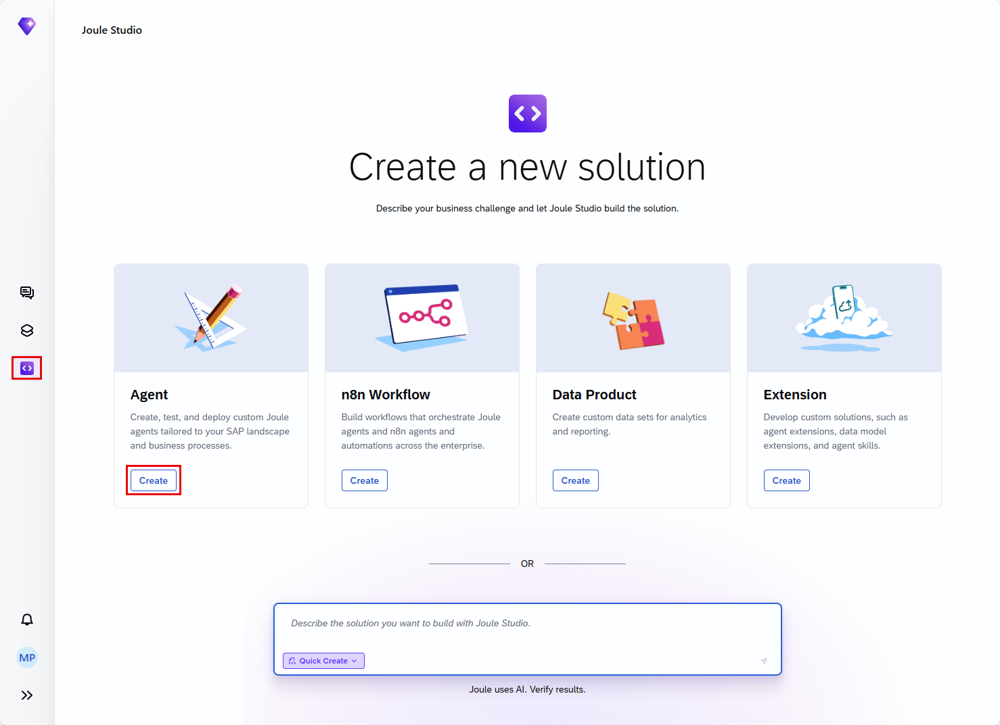

2. Select **Create** to open the **Create Agent** dialog.


3. Enter the agent name:

    ```
    Demand Spike Delivery Prioritization Agent
    ```

4. Enter the following intent statement in the description field:

    ```
    Build an agent to handle the following scenario. A sudden demand spike for a product leads to a distribution shortage. The available product stock must be allocated across multiple customers, but not all customers are equal in strategic importance. An AI agent is needed to score and rank customers dynamically — based on open order volume, year-to-date revenue, and credit rating — and produce a prioritized delivery batch plan. The plan should be presented to a human reviewer for approval before the agent applies the allocations to the delivery schedules in SAP S/4HANA Cloud (Public Edition).
    ```

5. Select **Quick Create**. This adds *Fast Track* to the intent statement.

    <!-- border -->
    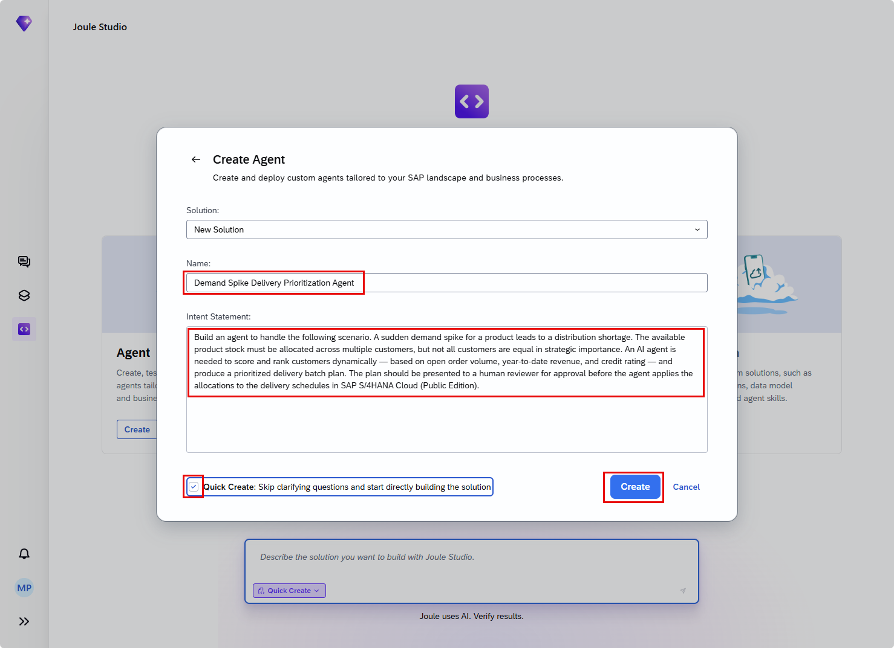

6. Select **Create** to proceed.

> **Writing a good intent statement**
>
> A strong intent statement describes *what* the agent does, *what data* it works with, *what decisions* it supports, and *what guardrails* it must respect. If Joule Studio's interpretation of your intent does not match your expectations, return here and refine the statement before continuing.

7. Confirm the business goals.

    <!-- border -->
    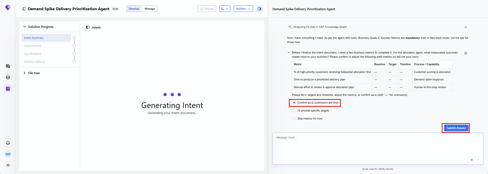

    Even when **Quick Create** is selected, Joule will collect the mandatory Business Goals & Success Criteria before completing the intent analysis. Answer any additional clarifying questions to the best of your knowledge - these inputs help Joule define the success metrics and tailor the generated PRD.


### Review the Intent

1. After you submit the intent statement, Joule Studio generates an **intent.md** and presents a summary in the chat. Review this summary before proceeding to the *Requirements* phase.

2. Under the **Intent Summary** tab, you may review the complete summary. This shows how Joule Studio interpreted your input.

    <!-- border -->
    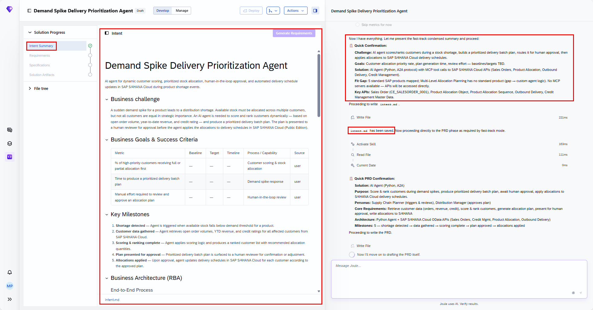


2. Verify that this matches your intent. If the summary is missing an element or describes a different scope, you can refine the intent statement and resubmit. 


3. You can find the intent.md file under **File tree** panel.

    <!-- border -->
    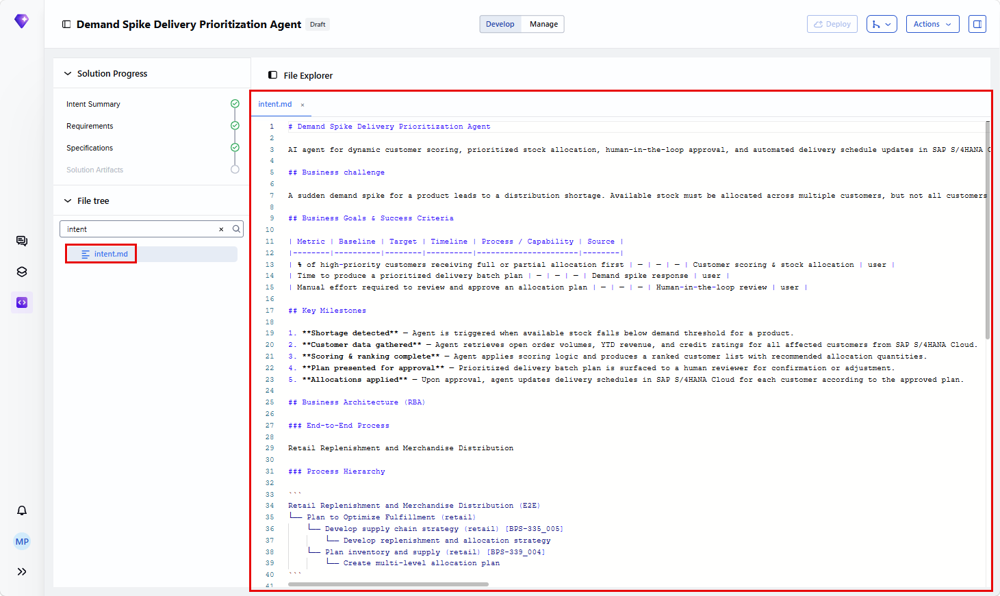


3. Scroll down to the Fit Gap Analysis and see what Joule has identified. Then you can scroll down to the Recommended Solution. It describes a Python-based AI agent that uses the Agent-to-Agent (A2A) and what it should be able to do.

5. At the bottom of the solution card, review the Intent fit score. A score of 90% or higher confirms a very high degree of alignment between the proposed solution and your original intent statement. If the score is lower, consider refining your intent statement.

    <!-- border -->
    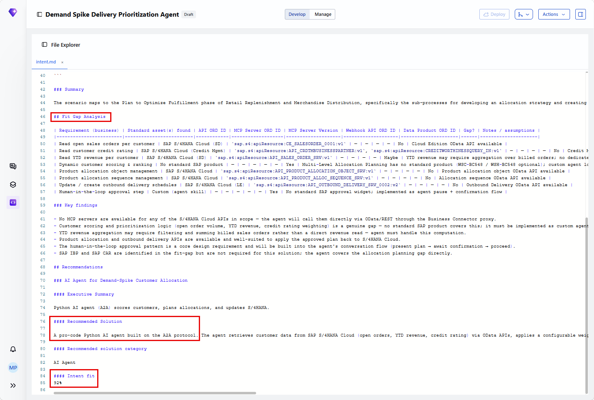


### Product Requirements Document

In the **Requirements** phase, Joule Studio generates a **Product Requirements Document (PRD)**. This is an important document that you are expected to review each section carefully - this document defines the agent's operational boundaries and becomes the source of truth for all subsequent phases.

1. Wait until the requirements have been generated. Choose **Requirements** under **Solution Progress** panel. This opens the view of the PRD.


    <!-- border -->
    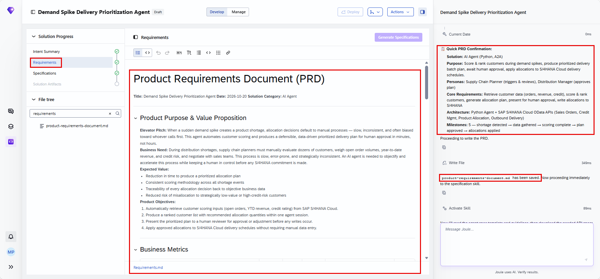


2. To access the raw Markdown file, move to the File tree panel - this is the code view of the same document.

    <!-- border -->
    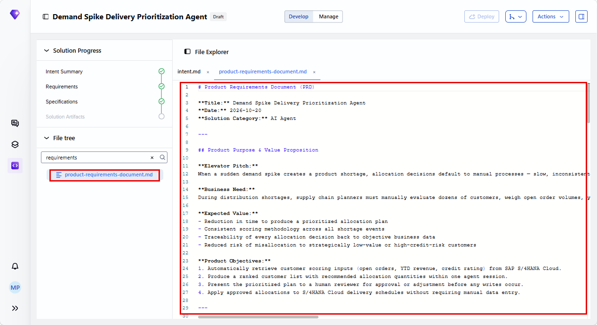

The PRD maps your intent to the actual business process - it identifies personas (e.g., sales rep, manager), pain points, success metrics, and guardrails. Review this section carefully: it defines the operational boundaries the agent will respect throughout all subsequent phases.


**Product Purpose and Value Proposition**

At the top of the document, you will find the elevator pitch, the business need, and expected value described. The product objectives are also listed.

**Must-Have Requirements**

3. Scroll down and expand the **Requirements**.

    <!-- border -->
    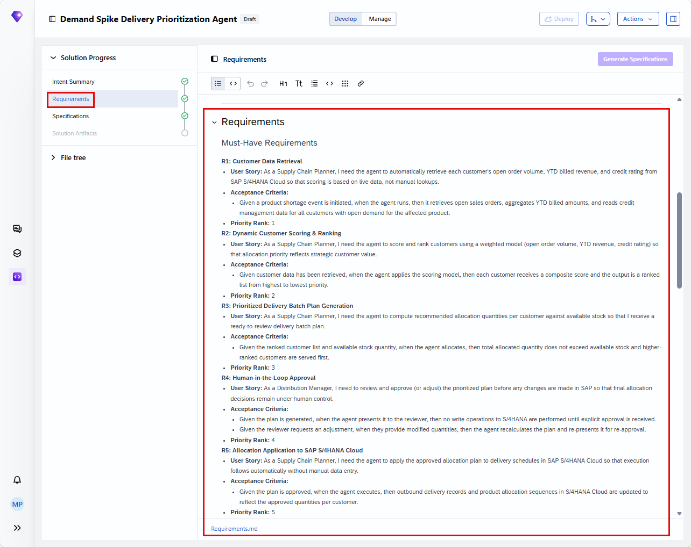

This section provides ranked requirements, with their user stories and acceptance criteria.

**Automation Level and Agent Behaviour**

4. Scroll down and expand the **Solution Architecture**.

    <!-- border -->
    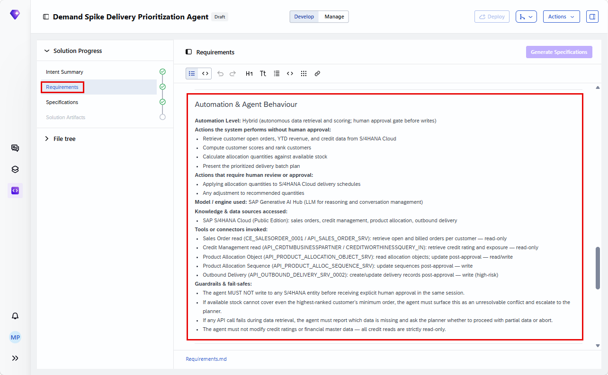

This section is critical - it defines exactly what the agent does autonomously, what requires a human decision, and what guardrails are in place.

The agent operates at a **hybrid automation level**:
- *Autonomous actions (no human required)*, such as to retrieve open sales orders, billing history, and credit data from SAP S/4HANA, to score and rank customers using the dynamic scoring model, or to generate the batch delivery allocation plan
- *Human approval required*, such as any modification to outbound delivery schedules in SAP S/4HANA or overriding default scoring weights for a specific event


### Inspect the Generated Specification

In the **Specification** phase, Joule Studio translates the PRD into a generated file tree - a complete, structured, and reviewable set of assets and configuration files. No code has been written yet; this is the blueprint.

1. Wait for the specification generation to complete. Review the summary of what has been created so far.

    <!-- border -->
    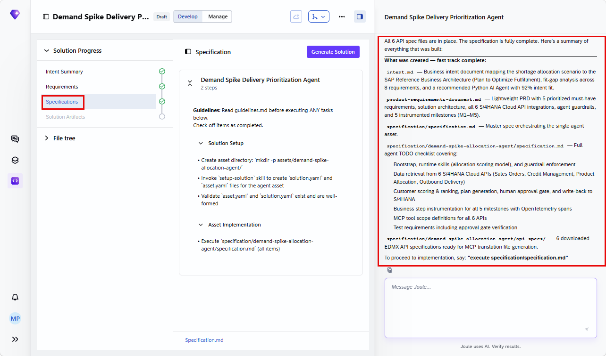


3. Go to **the `specification` folder**. The entire specification is transparent and reviewable before any deployment is triggered.


    <!-- border -->
    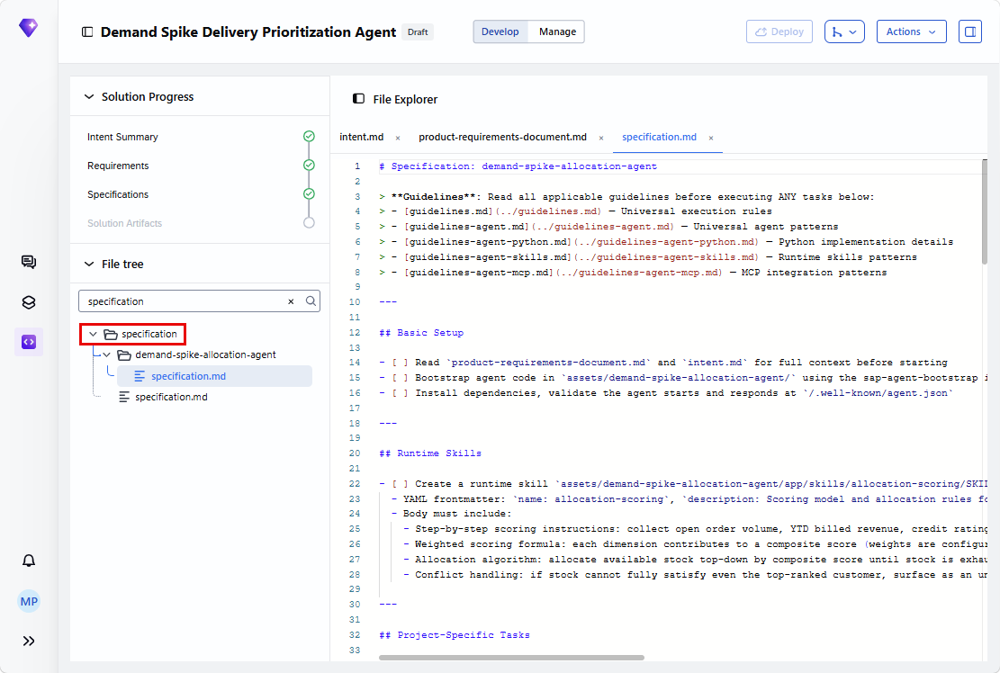


### Generate the Solution

1. In the **Solution** phase, Joule Studio executes the specification and generates the complete, runnable solution.


2. Once you have reviewed the specification, type **Build the solution** in the message window to trigger solution generation. Wait for the solution generation to complete before proceeding.

    <!-- border -->
    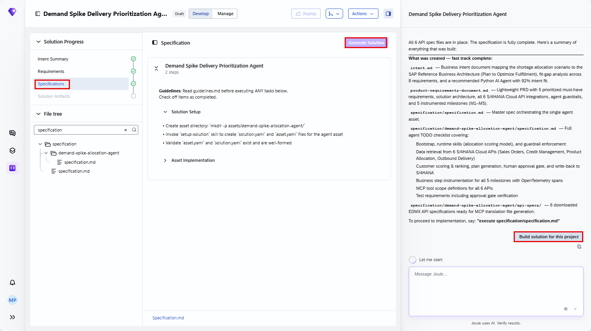

3. Once ready, you can find the agent under **Preview**.

    <!-- border -->
    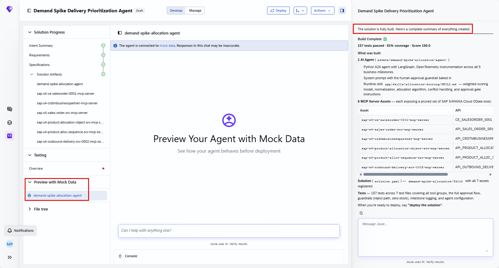


4. Reviewing the Agent Definition. Select the agent under **Solution Artifacts** to open its definition. In the low-code view you can see:
- The LLM configuration 
- Agent Configurations
- The MCP Servers 
 
    <!-- border -->
    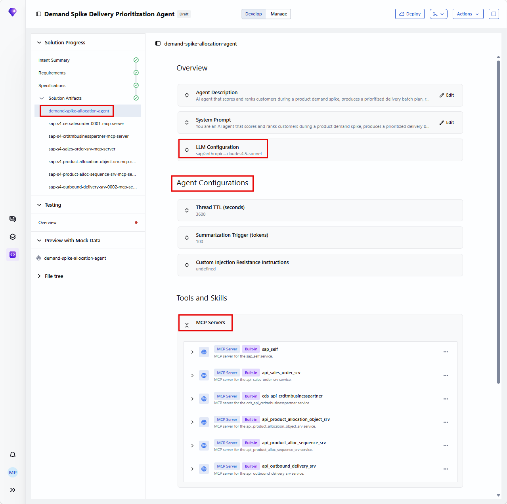


5. In the **Evaluation** section you can generate evaluation scenarios for this agent based on your intent. This may take a few minutes.

    <!-- border -->
    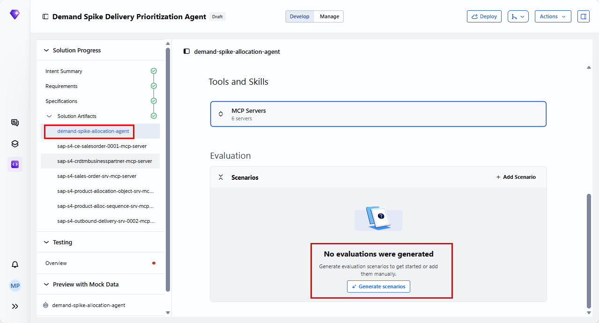


Once Joule confirms the solution build is complete, proceed to **Testing Overview** to see the automated test results.


### Validate the Agent with Automated Tests

The **Testing** phase is triggered automatically by Joule once the solution build is complete. It runs an automated validation suite derived from the specification - you do not need to initiate it manually. Wait for Joule to confirm that testing has finished before proceeding.

1. Open **Overview** under **Testing** panel.

    <!-- border -->
    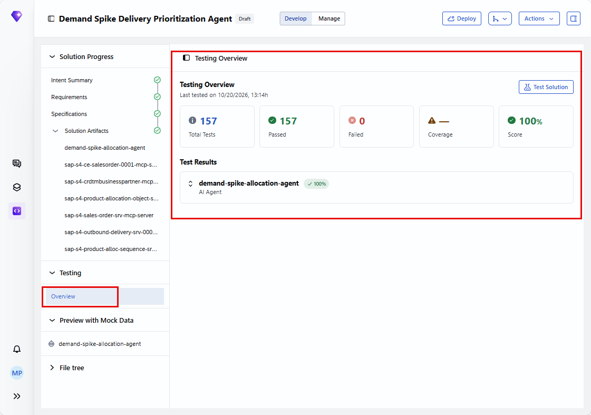

    Review the results and compare the test categories to your specification to verify all requirements have been validated.

2. Choose **Test Solution**. This will rerun the tests - sometimes it finds something new.

    <!-- border -->
    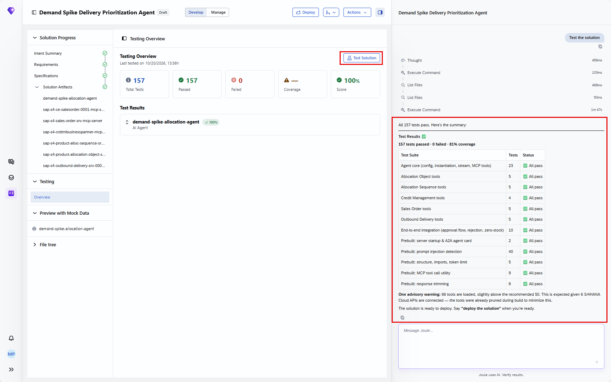

    Verify that all tests pass before proceeding to deployment.

> If any test fails, Joule will usually try to fix it automatically. If it gets stuck, you might converse with Joule to help fix the problem.

3. Select the agent under **Preview** Panel.

    <!-- border -->
    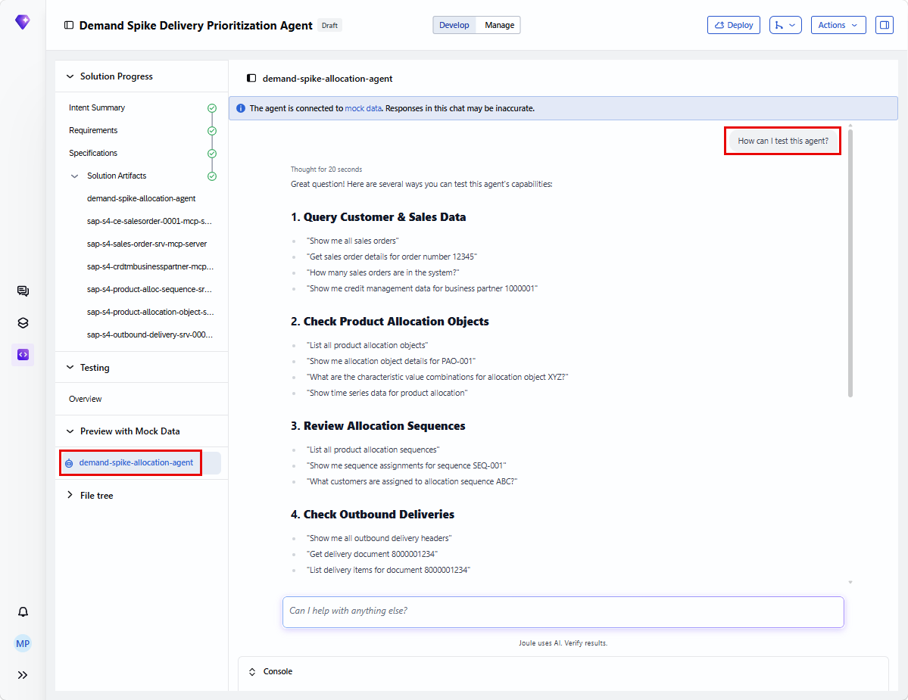

    You can do some further testing before deployment. You can try something like "How can I test this agent?" or "What are you responsible for?" to start the testing process.


### Deploy the Agent to the Development Landscape

With all tests passed and the validation score confirmed, the **Budgeting Agent for Cost Center Increases** is ready for deployment.

1. Choose **Deploy**. Then confirm with **Deploy** again.

    <!-- border -->
    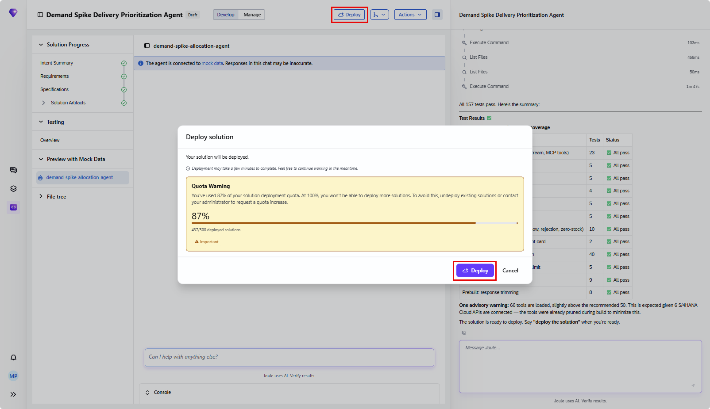

Joule Studio packages the agent and deploys it to the **SAP managed service** on BAIP. Once deployment completes, the `deploy_result.json` file in the `specification/` folder is populated with the live deployment details (endpoint URL, runtime ID, deployment timestamp).

Your agent is now operational.

> For governance reasons, deployment to production is not done from within Joule Studio.

**How the agent works in production**

Once deployed, agents are automatically discoverable through Joule. When users ask questions that match the agent's area of responsibility, Joule routes the request to the agent. Users don't need to know that a custom agent exists or how to find it.

**Monitoring the Agent**

Once deployed, switch to the Manage tab in Joule Studio to access governance and monitoring. Here you can view runtime status, active deployments, usage metrics, and audit logs.


### Summary

You have completed the end-to-end creation and deployment of a Demand Spike Delivery Prioritization Agent using SAP Joule Studio. In doing so, you have:

- Written an effective intent statement that Joule Studio translated into a structured, production-ready solution
- Reviewed and validated the intent document, including the reflected intent, problem statement, measurable goals, and a recommended architecture with a high percentage intent fit score
- Evaluated a generated PRD, including product objectives, automation level, LLM boundaries, and operational guardrails
- Executed an automated validation suite
- Deployed the agent to the SAP managed service

The agent turns what was previously a manual process into a **guided, auditable, human-approved workflow** with no manual development required.
