# Create an Extension for a Standard Agent

## Prerequisites

- Access to **Joule Studio**
- Access to an **SAP S/4HANA Cloud** system with the **Financial Closing Assistant** configured

## You will learn

- How to call the standard agent in Joule Work
- How to create an extension for the standard agent in Joule Studio

## Intro

>**IMPORTANT**
>
>**Welcome to the Agent lab**
>
>You are working with a pre-release version of the Joule Studio. This gives you an early look at our upcoming capabilities. Please keep the following in mind:
>
> - **Features are subject to change:** The UI, terminology, and functionality you see may differ from the final product.
> - **Educational use only:** This environment is designed for learning and experimentation, not for production use.
> - **Potential instability:** As a preview version, you may encounter occasional instability or unexpected behavior.

>**Restrictions regarding extensions in the agent lab**
>
>A deployed extension prevents other solutions from extending the same agent. Your user does not have the authorization to deploy extensions.

**About the Journal Entry Agent**

With the Journal Entry Agent, your finance team can significantly reduce the time and effort required to prepare and post journal entries — without compromising auditability or compliance. The agent automates data conversion and allows accountants to identify and resolve issues early, reducing rework, minimizing posting errors, and standardizing journal entry processing across the organization.

The solution generates upload-ready journal entry proposals directly from raw data files. It notifies users when proposals have been successfully generated and delivers them for review, management, and posting in the Manage Journal Entry Proposals app.

**How the agent works**

You interact with the Journal Entry Agent through the Joule chat window. By submitting a request and uploading a data file, you instruct the agent to analyze the content and generate journal entry proposals based on the data in the file.

The agent creates proposals rather than final postings, allowing you to review, validate, and adjust the proposed journal entries before posting them in the Manage Journal Entry Proposals app.

**Spreadsheet Requirements**

The Journal Entry Agent requires spreadsheet-based input. You must upload a Microsoft Excel file (.xlsx or .csv). A single uploaded spreadsheet can result in a maximum of 999 journal entry proposals.

The file does not need to follow a predefined template — the agent scans the spreadsheet and proposes a mapping between the file columns and the journal entry fields. The uploaded data must include values that can be mapped to the following mandatory fields:

- Journal Entry Date
- Posting Date
- Journal Entry Type
- Company Code
- Transaction Currency
- G/L Account
- Debit Amount
- Credit Amount

In this exercise, a prepared data file is provided for you. You will use it together with a natural language prompt to trigger the agent.


### Understand the Business Challenge

**Current pain points**

The standard Journal Entry Agent in Joule Works takes a natural language prompt, process it, and makes the proposal directly in SAP S/4HANA Cloud, Public Edition — no additional checks, no validations, no enrichment. The agent does exactly what it was built to do out of the box. Real-world finance processes are rarely that simple. Consider what a finance team might actually want:

- Before posting: Flag unusually high amounts so a controller can review before the document hits the books.
- During processing: Check whether the combination of cost center, GL account, profit center, and segment is valid for your organization — rules that are specific to your chart of accounts and not built into the standard agent.
- With more context: Pull in existing posting data for the same cost center and GL account so the agent can make a more informed decision.
- After posting: Automatically generate a structured summary for audit, reporting, or team notification — without the user having to do anything extra.

None of this is in the standard agent. But all of it can be added — without building a new agent from scratch.

### Preparation

Download the sample file [agent_lab_journal_entry.xlsx](https://github.com/sap-tutorials/joule-studio/blob/main/tutorials/create-agent-extension/agent_lab_journal_entry.xlsx) and save it to your desktop.


### Open Joule Work and Call the Assistant

This exercise shows you how the call the agent that you are extending and how it behaves. If you only want to see how to extend an agent, you can skip this.

1. Open **Joule Work**.

2. In the chat window, enter the following prompt: 

    ```
    @Financial Closing Assistant Create Journal Entry Proposal from File
    ```

    <!-- border -->
    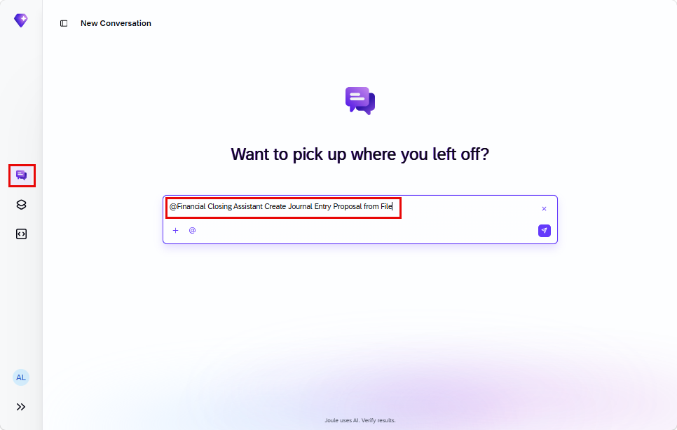

    By using **@Financial Closing Assistant** we are invoking the agent, and **Create Journal Entry Proposal from File** is the natural language prompt that tells the agent which action to execute.

    The agent responds by prompting for a file upload.

    <!-- border -->
    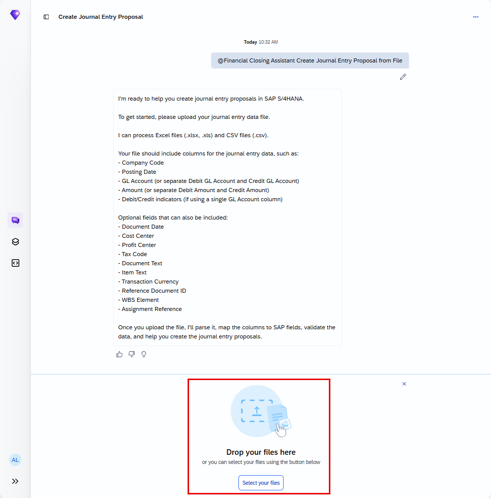

3. Click **Select your files** or drag and drop your Excel (.xlsx, .xls) or CSV (.csv) file containing the journal entry data (Company Code, Posting Date, GL Account columns) into the upload area.

    <!-- border -->
    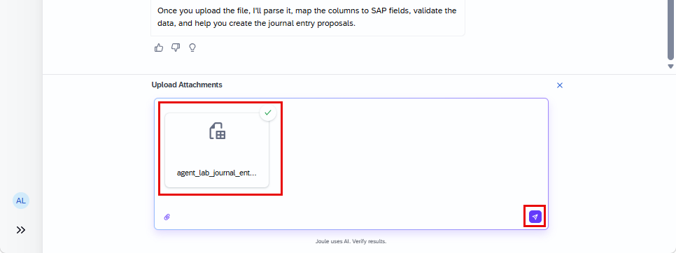


4. Click **Send**.

5. Click **Approve Mapping** to proceed.

    <!-- border -->
    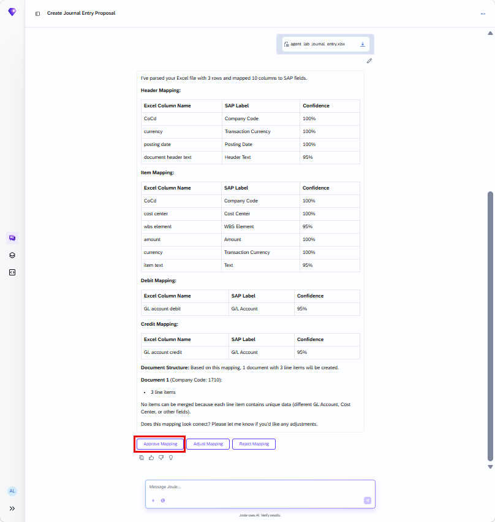

    The Journal Entry Agent processes your request and generates a journal entry proposal. You will see the agent's response in the chat window with a summary of the proposed posting.

    <!-- border -->
    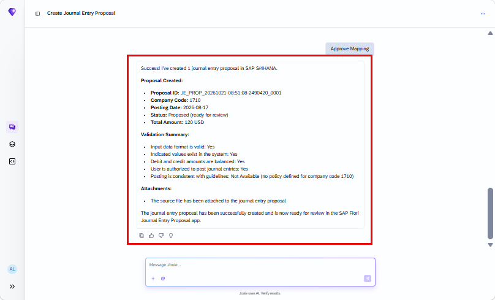

6. Review the response. The agent confirms the proposal is ready for review in the Manage Journal Entry Proposals app.

> What to observe: The agent processes the request and returns a proposal — no additional checks fire, no flags are raised, and no report is generated. This is the standard out-of-the-box behavior.

You have run the standard pre-delivered Journal Entry Agent. This is the baseline — the agent working exactly as delivered, with no custom extensions. In the next exercise, you will extend this same agent business-specific behavior using intent-based development in Joule Studio.

### Open Joule Studio and Define the Intent

In this exercise, you will create an **Instruction Extension** for the pre-delivered Journal Entry Agent using Joule Studio's Intent-Based Development (IBD) flow. The extension enforces a mandatory disclaimer on every agent response — ensuring users are always informed that the output is AI-generated.

1. Open **Joule Studio**.

    <!-- border -->
    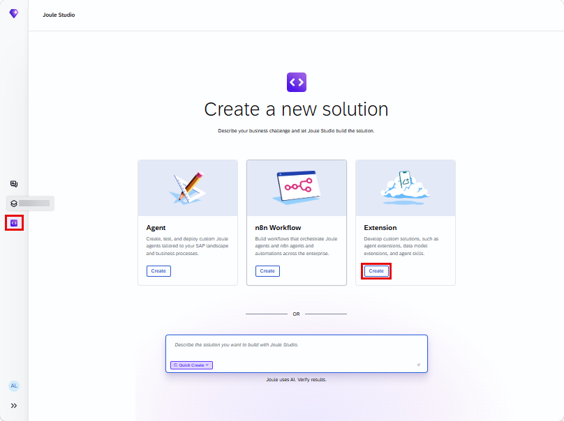

2. Select **Create** on the **Extension** tile to open the **Create an Agent Extension** dialog.

    <!-- border -->
    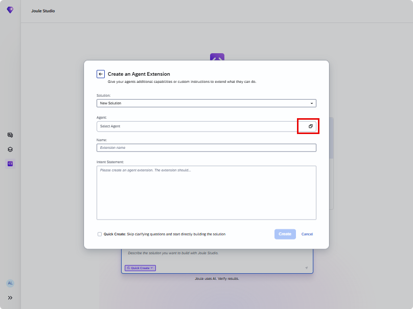

    You will now select the agent that is to be extended.

3. Search for the **Journal Entry Agent** in the **Agent Catalog** and choose **Add**.

    <!-- border -->
    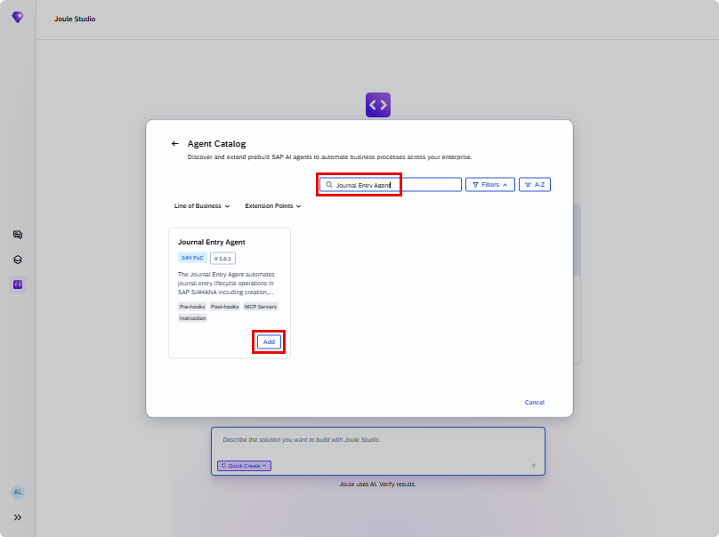

    You can see the extension points available for this agent.

4. Choose **Select Agent**.

    <!-- border -->
    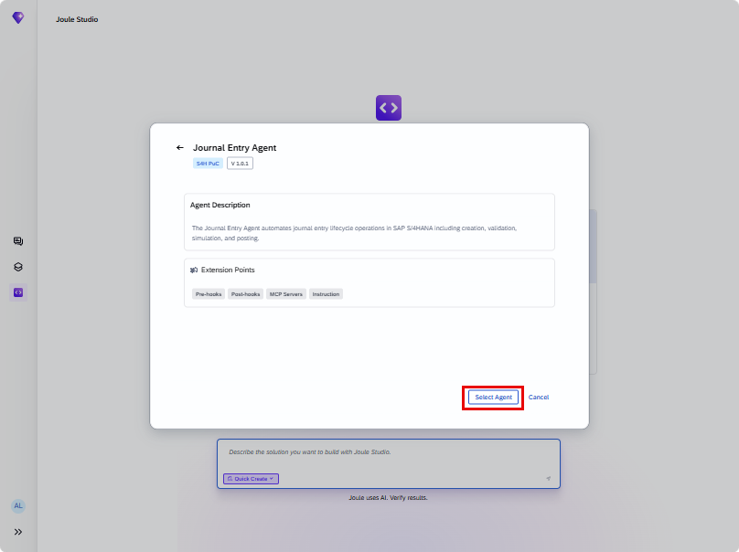

5. Enter the agent name:

    ```
    Journal Entry Extension
    ```

6. Enter the following intent statement in the description field:

    ```
    Please create an agent extension. The extension should add the following CRITICAL instruction
    that must be followed: PUT DISCLAIMER: This is an AI-generated response when responding back
    to the user.
    ```

    <!-- border -->
    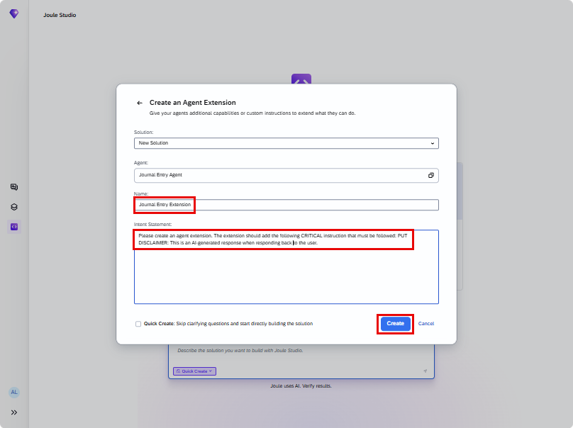

7. Choose **Create**.

     <!-- border -->
    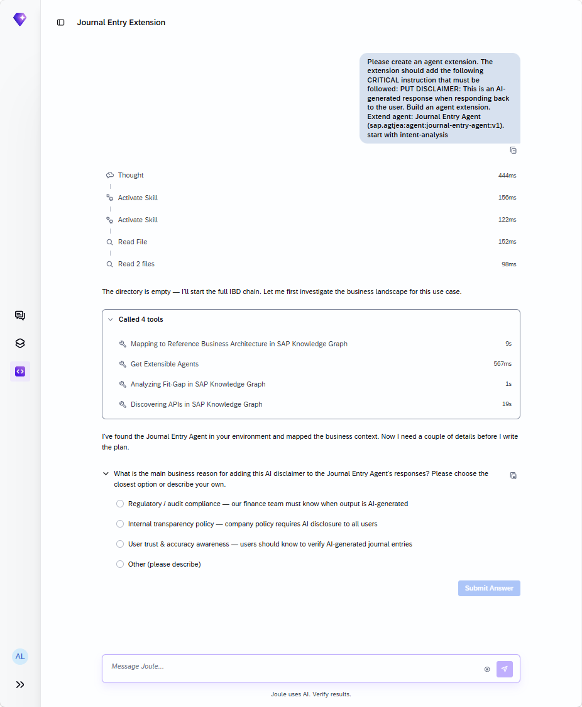

    There will follow some questions. What they are and how they are asked will vary. The following screenshots are an indication of what to expect.

8. Choose a business reason and the choose **Submit Answer**.

     <!-- border -->
    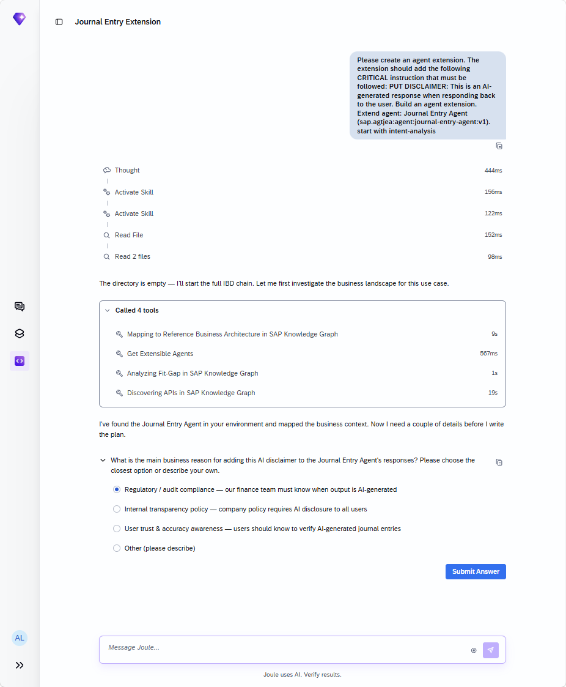

9. Answer any other questions that come and choose **Submit Answer**.

     <!-- border -->
    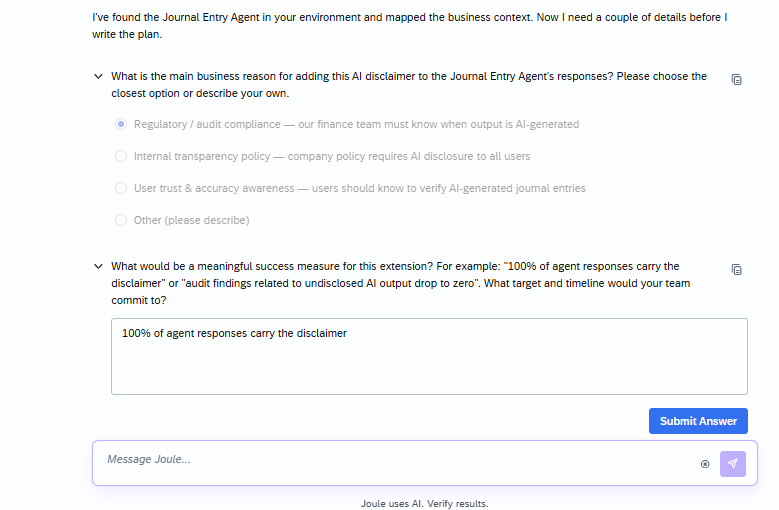

10. Review and confirm the intent analysis summary.

     <!-- border -->
    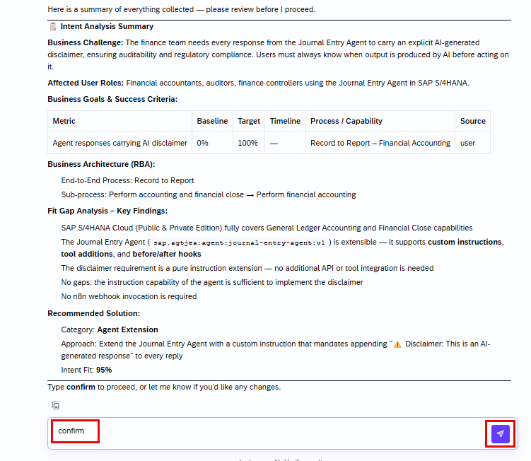

11. Click on **Intent Summary** under **Solution Progress**. Review the **Intent**.

     <!-- border -->
    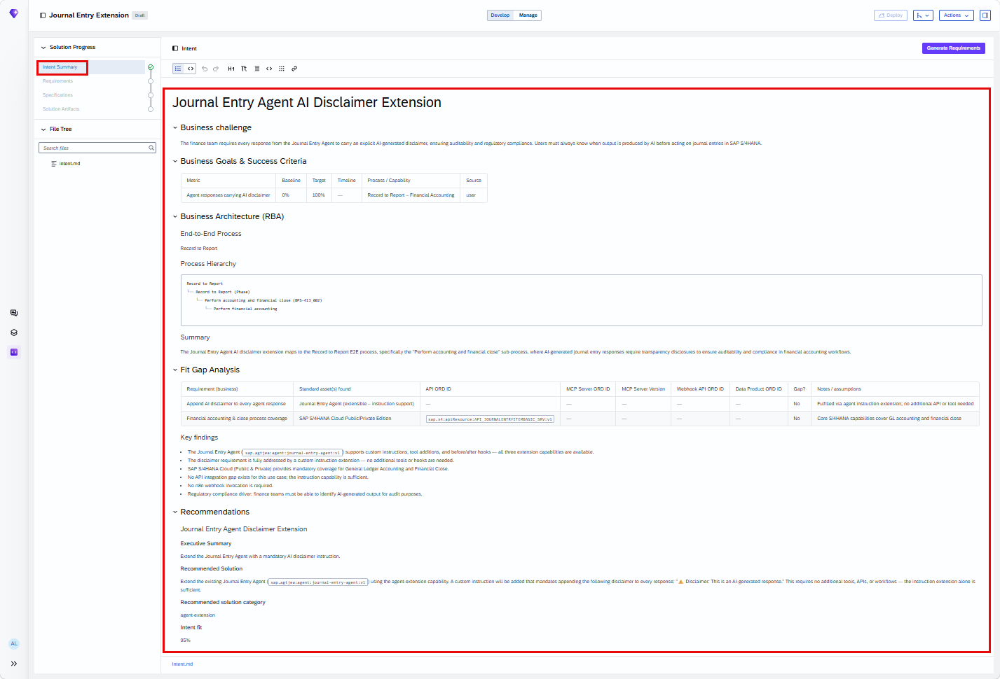

    You can also find the **intent.md** in the **File Tree**.

### Generate the Requirements and Build the Solution

1. Generate the requirements.

     <!-- border -->
    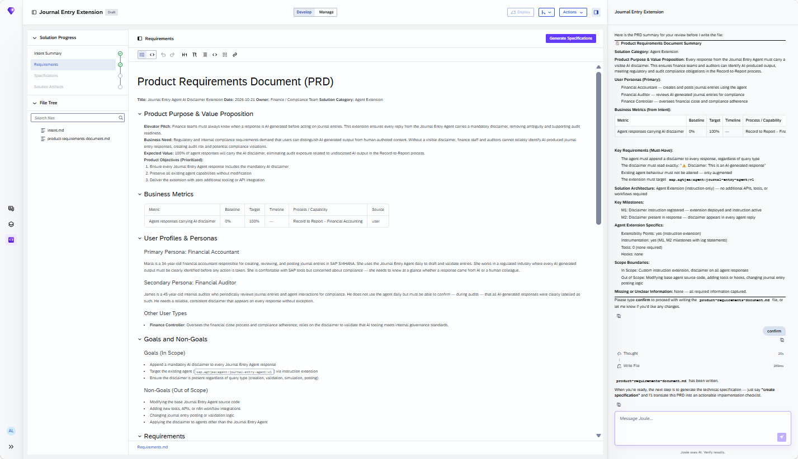

2. Create the specification.

     <!-- border -->
    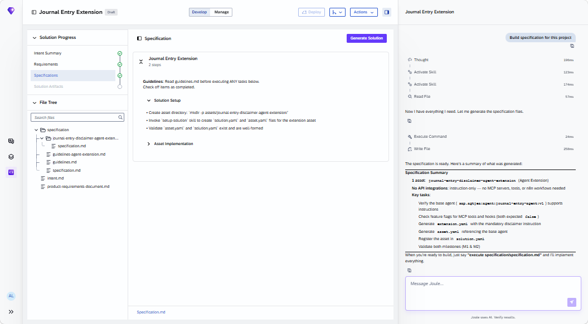

3. Build the solution.

     <!-- border -->
    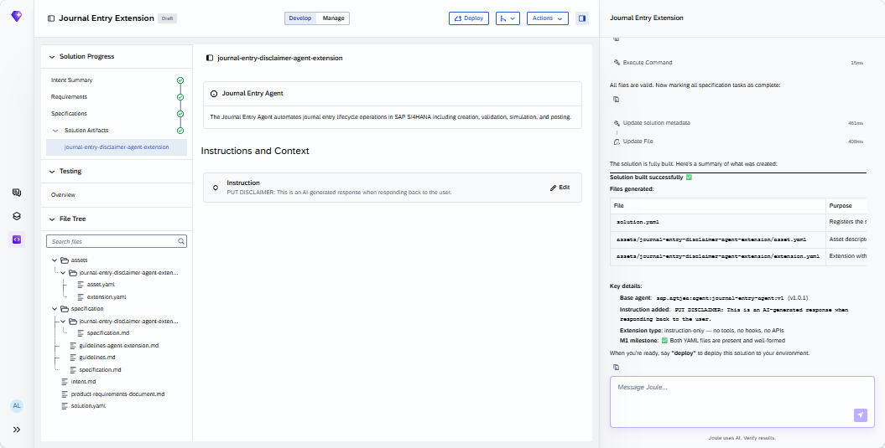

You have created an Instruction Extension for the pre-delivered Journal Entry Agent using Joule Studio's Intent-Based Development flow. Starting from a plain language intent statement, Joule Studio:

- Asked targeted clarifying questions to understand your business goal
- Produced a structured Intent Analysis Summary and PRD
- Generated a deployable extension.yaml artifact — with no manual YAML editing required

### Create a New Extension (Optional)

In this exercise, you will configure four extension layers for the Journal Entry Agent:

- Pre-hook: Runs before the posting is executed. Checks whether the GL amount exceeds €45 and flags it so the agent can warn the user before the document is created.
- Tool Extension: Connects the agent to the Journal Entry Line Items API via MCP Hub. Retrieves existing posting data for the same cost center and GL account — giving the agent more context when processing the request.
- Instruction Extension: A plain language business rule the agent follows at runtime. Validates that the combination of Cost Center, GL Account, Profit Center, and Segment is valid before accepting the posting.
- Post-hook: Runs after a successful posting. Generates an HTML summary report of the completed transaction for review or audit.

>**This section depends on features that might not be available in your system**
>
>If that is the case, when you get to the implementation, you will get something like  "MCP tools and n8n hooks are both disabled. Let me present the scope reconciliation to the user".

1. Create a new extension using the same standard **Journal Entry Agent**.

2. Enter the agent name:

    ```
    Journal Entry Extension
    ```

3. Enter the following intent statement in the description field:

    ```
    Before processing any journal entry, check if any line item amount exceeds €45. If it does, pause and ask the user for explicit approval before continuing.

    Once approved, validate the uploaded journal entry proposal against historical journal entry posting patterns in SAP S/4HANA Cloud Public Edition.To do this, query the Universal Journal — the single source of truth for all financial postings in S/4HANA Cloud — through the MCP tool to retrieve historical posting data. For each line item, compare the combination of Company Code, G/L Account, Cost Center, Profit Center, and Segment with previously posted journal entries.

    Tag each line as:

    Commonly Used — the accounting combination is frequently used in historical postings
    Rare Pattern — the combination exists but is uncommon or differs from the normal posting pattern
    No Historical Match — no historical posting with the same accounting combination exists
    For the validation outcome, automatically accept lines tagged as Commonly Used. For Rare Pattern and No Historical Match, provide an explanation and suggest commonly used historical combinations where available.

    Once validation is complete, generate a local HTML summary file and open it automatically in the browser. The summary shows a color-coded table — green for accepted lines, yellow for rare patterns, red for no historical match — along with the document number, timestamp, and suggestions for any flagged lines.
    ```

    <!-- border -->
    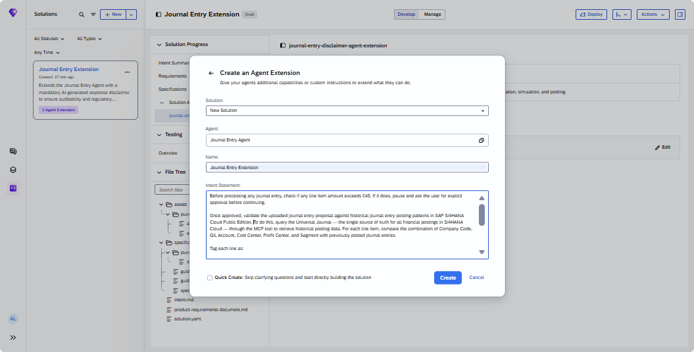

4. Answer the clarifying questions and confirm to proceed.

    <!-- border -->
    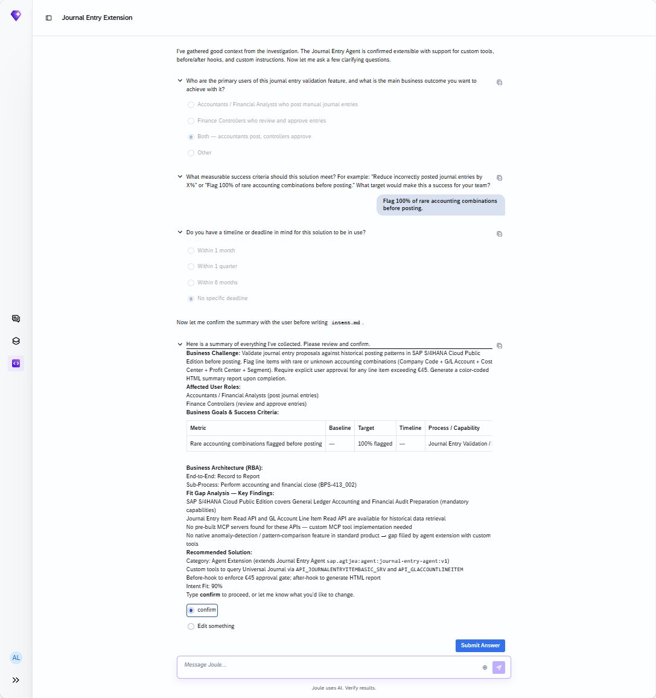

5. As you did in the previous extension, work through the intent based development steps until you have create the solution artifacts. Usually you just need to enter **proceed** to move to the next stage.

6. Explore the **Solution Artifacts**.

    <!-- border -->
    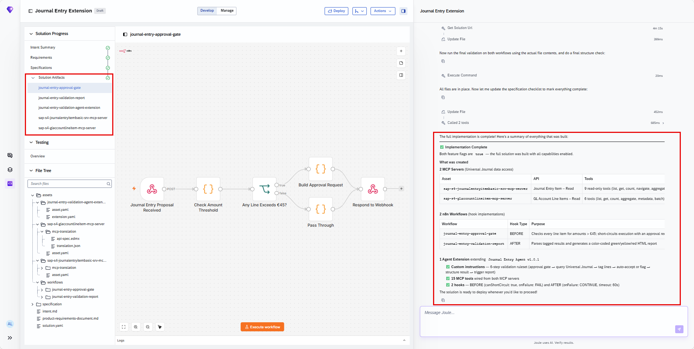

Do not attempt to deploy the extension in the Agent Lab. Your user does not have the required authorization - this is to prevent your extension from blocking the other participants.

### Summary

You have extended the pre-delivered Journal Entry Agent using intent-based development in Joule Studio. Starting from a plain language description of your business requirements, Joule Studio guided you through agent selection, specification review, artifact generation — all without writing a single line of code. This is the core value of agent extensibility on SAP Autonomous Suite: you bring the business knowledge, Joule Studio handles the translation into a working extension. The same pattern applies to any pre-delivered SAP agent — giving you a repeatable, low-effort path to tailoring agent behavior for your organization's specific needs — no specialist development skills required.

