# How to create an Invoice Exception Agent with an n8n Workflow

## Prerequisites

- Access to **Joule Studio**
- SAP S/4HANA connection configured

## You will learn

- Understand how SAP Joule Studio and n8n support agentic automation for financial processes.
- Create a new n8n workflow solution using Intent-Based Development.
- Explore the generated requirements, technical specifications, and solution artifacts.
- Visualize an AI-powered invoice exception-handling workflow combining SAP integrations, agent reasoning, and human approvals.

## Intro

>**IMPORTANT**
>
>**Welcome to the Agent lab**
>
>You are working with a pre-release version of the Joule Studio. This gives you an early look at our upcoming capabilities. Please keep the following in mind:
>
> - **Features are subject to change:** The UI, terminology, and functionality you see may differ from the final product.
> - **Educational use only:** This environment is designed for learning and experimentation, not for production use.
> - **Potential instability:** As a preview version, you may encounter occasional instability or unexpected behavior.

## Overview

Invoice exceptions such as price mismatches, quantity discrepancies, missing PO references all account for up to 25% of all invoices processed in a typical enterprise, each triggering a costly chain of manual investigation, approval chasing, and vendor back-and-forth. 

In this tutorial, you'll explore how SAP Joule Studio transforms natural language requirements into an n8n workflow for supplier invoice exception handling. The generated workflow illustrates how SAP integrations, an embedded AI Agent node, and human approval steps can work together to support intelligent invoice processing.


### The Business Challenge

Before building the solution, it helps to understand the problem it solves.

**What finance teams are dealing with today:**

- **Parked Invoice Backlogs**: Three-way match failures between purchase orders, goods receipts, and vendor invoices stall Accounts Payable and pile up unresolved in SAP.

- **Working Capital Impact**: Delayed resolution means lost early payment discounts, strained supplier relationships, and a direct hit on Days Payable Outstanding (DPO).

- **Manual Triage Overhead**: AP teams spend significant time digging through S/4HANA, chasing procurement for clarification, and re-routing approvals which is work that doesn't require their expertise but consumes it anyway.

- **Month-End Exposure**: Unresolved exceptions at close create accrual uncertainty and audit risk that finance controllers can't afford.

**What this n8n workflow addresses:**

- **Automated Exception Classification**: An embedded AI Agent node is designed to analyze invoice exceptions using relevant SAP business data.
- **Intelligent Routing**: The workflow is designed to present findings and recommendations to AP clerks for review and approval.
- **Improved Process Efficiency**: Automating repetitive investigation steps has the potential to reduce manual effort and accelerate invoice exception resolution.

### Open Joule Studio and Define the Workflow Intent

The **Intent** phase is the starting point of every solution in Joule Studio. You describe what you want the build in plain natural language - no technical specification required at this stage.

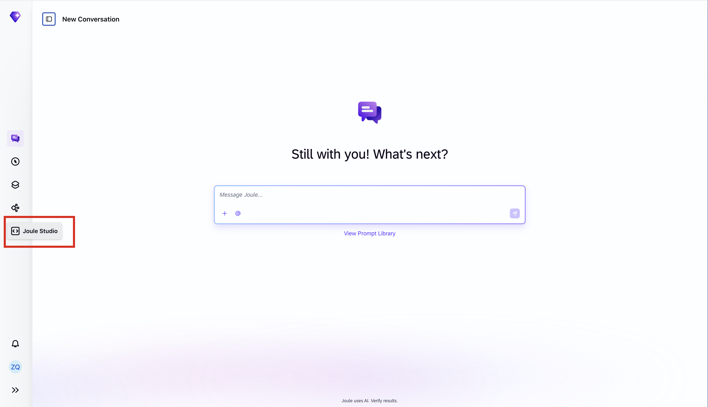 

1. Open **Joule Work** and navigate to **Joule Studio** by selecting **Joule Studio** in the left navigation panel.

2. You should see **Create a New Solution** dialog. If it's not your first project in Joule Studio then this dialog is not visible. To enable it in the **Solutions** pane on the top-left corner, select **New**. 

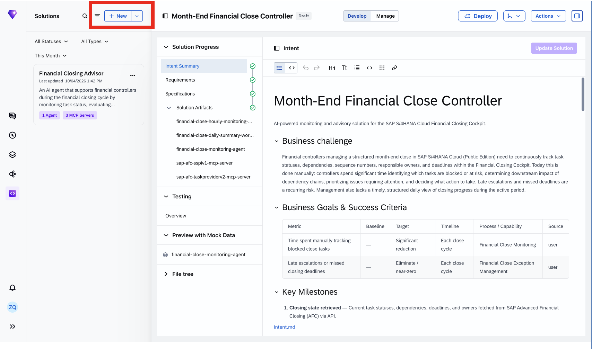

3. Choose **Create** in the **n8n Workflow** tile.

4. Complete the three fields in the dialog:

    - **Solution**: Select **New Solution** to create this workflow as a standalone solution.
    - **Name**: Enter the following workflow name:
         ```
        Invoice Exception Agent
         ```
    - **Intent Statement**: Enter the following statement in plain natural language:
        ```
        Create an n8n workflow with a webhook trigger, triggered by a Joule Agent from SAP Joule chat. The workflow reads all blocked supplier invoices from SAP S/4HANA Cloud using the SAP MCP Client, analyses each invoice using a SAP Agent to identify the block reason across Purchase Order, Goods Receipt, and Supplier Contract, presents the agent's findings to the AP Clerk in SAP Task Center using SAP Human-in-the-Loop, and — if the AP Clerk approves — releases the invoice in S/4HANA Cloud via the SAP MCP Client.
        ```

    - Keep the **Quick Create** option checked.

5. Choose **Create** to proceed.

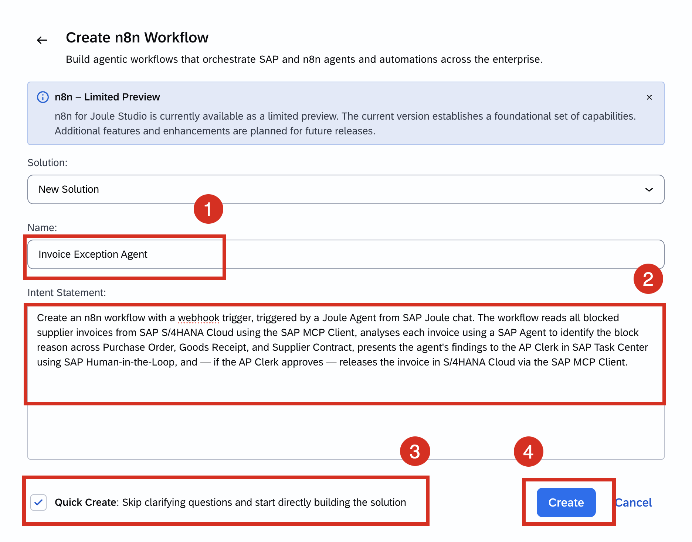

6. After submitting your prompt, Joule analyses your intent by invoking the **intent-analysis** skill and grounds the proposed solution using the SAP Knowledge Graph which is a semantic map of your SAP entities (Supplier, Purchase Order, Invoice) and the relationships between them. It discovers the OData APIs that connect those entities, so rather than generating a generic response, Joule knows the actual API path from a Supplier to a Purchase Order to a Goods Receipt in your S/4HANA system and uses that to propose something accurate and actionable.

Explore the invoked **intent-analysis** skill by clicking on **Activate Skill** on the Joule chat panel on the right.

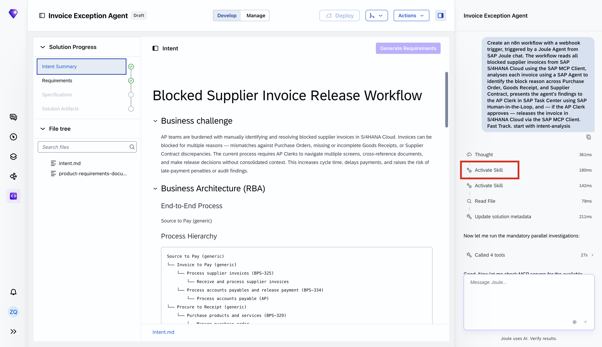

Scroll down and you'll notice the SAP Knowledge Graph has already been invoked automatically. It's traversing your SAP data model to surface the APIs and business relationships i.e Supplier, Purchase Order, Goods Receipt...etc. that give your agent the context it needs.

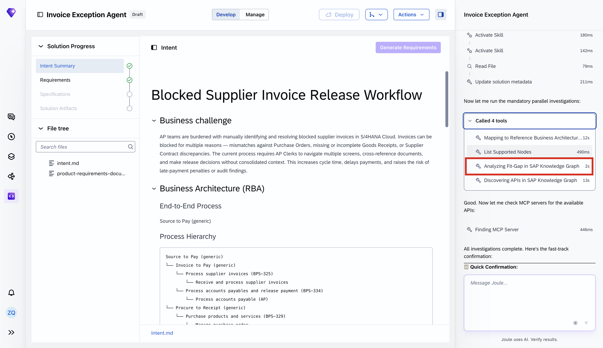

7. Take a moment to explore the Intent Summary that was created:

**Native Integration with SAP Signavio**: Joule ingests your as-is BPMN process models and variant analyses from SAP Signavio to ground the generated solution in your actual process structure, not generic SAP templates.

**Fit-Gap Analysis**: Joule traverses the SAP Knowledge Graph to map your intent against existing SAP capabilities, BTP services, and pre-built agents, surfacing what's already covered and what requires custom development, scoped to clean-core extensibility principles.

**Intent Fit**: A semantic alignment score between your original intent statement and the generated Technical Specification, giving developers and business stakeholders a shared signal to refine requirements before committing to implementation.

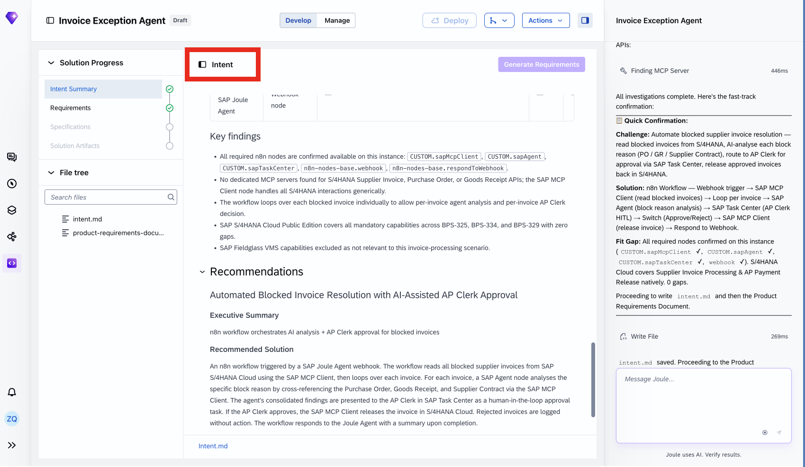

8. **Solution Progress** on the left-hand side tracks where you are in the development pipeline. Each completed step is marked with a checkpoint, giving you a clear view of what's done and what's next. 

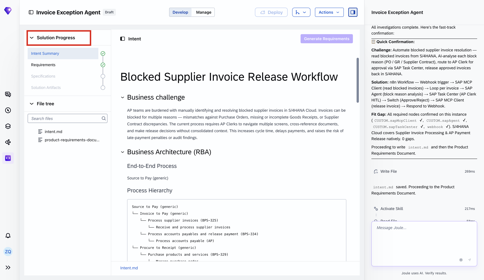

9. Everything is file-based and version-controllable under the file tree. You can edit directly in the .md file, within the Intent Summary itself, or through the Joule chat interface. All changes are reflected in real-time across the project.

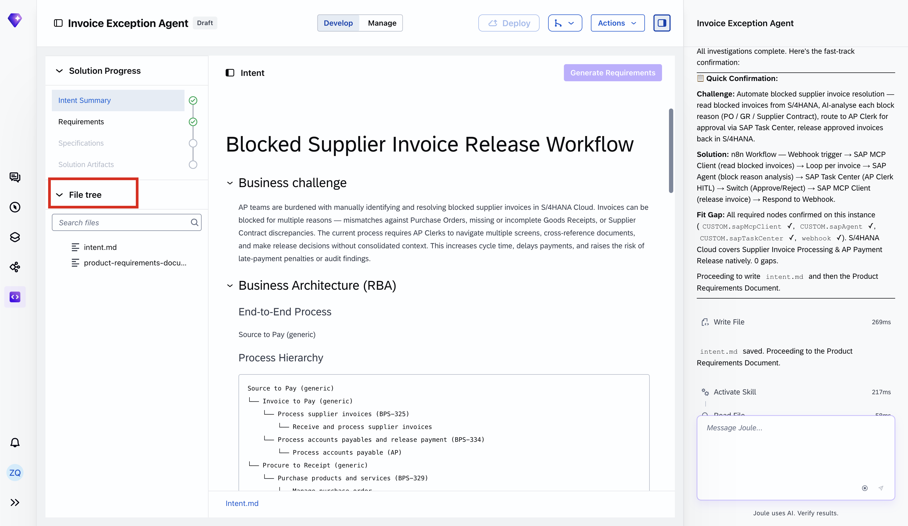

### Review the Product Requirements Document

Once the **Intent Summary** is generated, Joule will proceed to create your **Product Requirement Document (PRD)**. Review it carefully as it defines the workflow's functional requirements, data scope, automation boundaries, and guardrails.

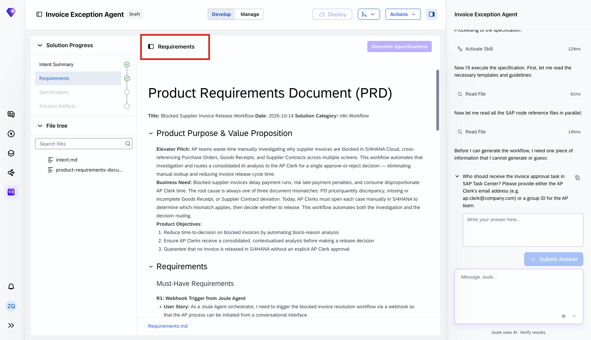

**Product Purpose and Value Proposition**

**Elevator Pitch**: Accounts Payable (AP) teams manually investigate blocked supplier invoices in S/4HANA Cloud, cross-referencing POs, Goods Receipts, and Supplier Contracts across multiple screens. This workflow automates that investigation and routes a consolidated AI analysis to the AP Clerk for a single approve-or-reject decision, cutting manual lookup and reducing invoice release cycle time.

**Business Need**: Blocked supplier invoices delay payment runs, risk late-payment penalties, and consume disproportionate AP Clerk time. The root cause is always one of three document mismatches — PO price/quantity discrepancy, missing Goods Receipt, or Supplier Contract deviation, each requiring manual investigation in S/4HANA. This workflow automates both the investigation and decision routing.

**Expected Value**: Automate block-reason analysis to accelerate time-to-decision, ensure AP clerks receive a consolidated analysis before every release decision, and enforce explicit AP Clerk approval as a mandatory gate before any invoice is released in S/4 HANA

**Product Objectives (in priority order)**

1. Reduce time-to-decision on blocked invoices by automating block-reason analysis.
2. Ensure AP Clerks receive a consolidated, contextualized analysis before making a release decision.
3. Guarantee that no invoice is released in S/4HANA without an explicit AP Clerk approval.

**Solution Architecture**

 By querying your SAP LeanIX Enterprise Architecture repository, Joule generates a landscape-aware architecture recommendation: target systems, relevant APIs, integration patterns, and cross-system dependencies, before any code is written.

**Automation Level and Agent Behavior**

The Invoice Exceptions n8n workflow operates at a **hybrid automation level**: all data retrieval and optimization is performed autonomously; any action that modifies SAP S/4HANA data (invoice release decision), the AP clerk must explicitly approve it through SAP Task Center.

*Autonomous actions (no human input required):*
- Reading blocked invoices from S/4HANA Cloud
- Retrieving PO, GR, and Supplier Contract data for each invoice
- Running the SAP Agent analysis per invoice
- Creating the SAP Task Center approval task
- Returning the final summary to the Joule Agent caller

*AP Clerk approval required for:*
- Invoice release decision: AP Clerk must explicitly approve in SAP Task Center before any release is executed in S/4HANA Cloud

**Guardrails & Fail-Safes**

Four operational guardrails are built into the workflow:

1. **Human-in-the-Loop Approval**: Every invoice release requires explicit AP Clerk sign-off via SAP Task Center and no automated release path exists.
2. **Safe Rejection Handling**: Rejected invoices trigger no write-back to S/4HANA Cloud, ensuring no unintended changes to the system of record.
3. **Resilient Webhook Handling**: The workflow always returns a response to the Joule Agent, even when individual processing steps fail, preventing hanging webhook connections.

Rather than assuming, Joule prompts you directly for the approver the invoice task should be routed to.

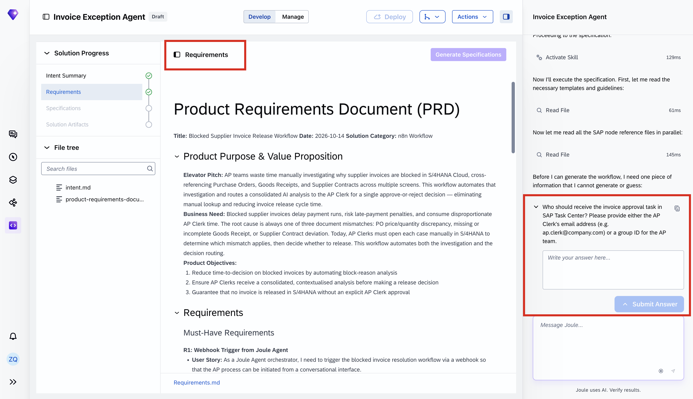

Once you have reviewed the PRD and confirmed it accurately reflects your requirements, Joule will start generating the **Technical Specification**.

### Explore the Generated Workflow Specification

Once the solution artifacts have been generated, navigate to the **Specifications** section.

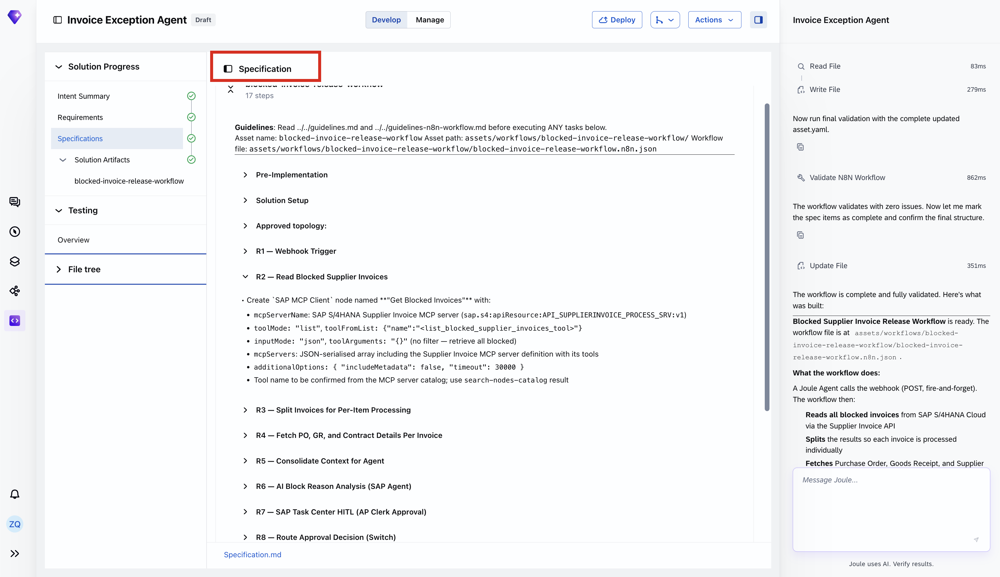

The specification provides a **detailed technical blueprint** for the invoice exception-handling workflow. It translates the previously defined business requirements into individual implementation steps, outlining the components, integrations, and processing logic needed to build the solution.

In this example, the workflow is designed to:

1. **Trigger the workflow**: Receive a request through a webhook, which can be invoked by a Joule agent.

2. **Retrieve blocked invoices**: Use the SAP MCP Client to retrieve blocked supplier invoices from SAP S/4HANA Cloud.

3. **Collect relevant business context**: Retrieve the associated purchase orders, goods receipts, and supplier contract information for each invoice.

4. **Analyze invoice exceptions**: Use an AI agent to investigate potential discrepancies and identify the reasons invoices are blocked.

5. **Request human approval**: Route the agent's findings to an Accounts Payable (AP) clerk through SAP Task Center for review and approval.

6. **Execute approved actions**: Based on the approval decision, initiate the appropriate action, including releasing an invoice through the SAP MCP Client where permitted.

Expand the individual sections of the specification to explore how each step is defined and how the components work together.

**Note**: The specification represents the intended implementation of the workflow. It does not mean that all integrations, AI agent configurations, or execution capabilities are ready to use. This preview exercise focuses on exploring the generated solution rather than executing or deploying it.

> **Architecture note:** The n8n workflow embeds an AI Agent node to analyze blocked supplier invoices using purchase order, goods receipt, and supplier contract data from SAP S/4HANA Cloud. The agent identifies potential discrepancies and recommends next steps, which are routed to an AP clerk for review and approval through SAP Human-in-the-Loop.

### Explore the Generated Solution Files

Navigate to the File tree section in the left navigation panel to open the File Explorer.

The File Explorer provides access to the generated solution artifacts, including the workflow definition, technical specifications, and supporting configuration files.

For this scenario, you can explore:

1. **specification.md** which contains the technical implementation plan, including the workflow topology, individual processing steps, and integration requirements.

2. **assets** which contain the generated n8n workflow artifact, including its JSON definition.

3. **solution.yaml** which defines the solution structure and associated assets.

Select specification.md to inspect how the invoice exception-handling requirements are translated into technical implementation instructions.

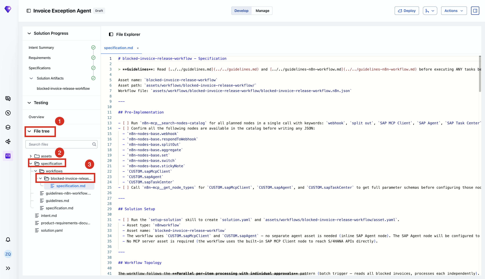


### Explore the Generated n8n Workflow

Once the solution has been generated, navigate to **Solution Artifacts** and select blocked-invoice-release-workflow to open the visual n8n workflow editor.

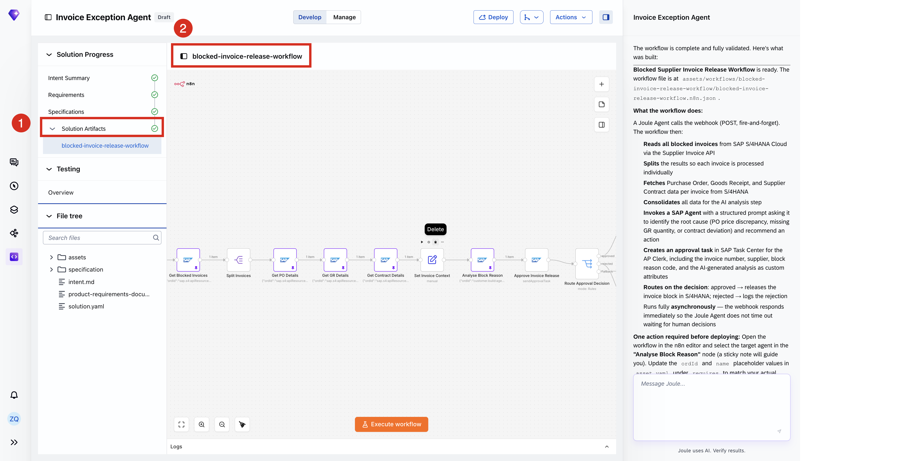

The generated workflow illustrates how different components work together to automate supplier invoice exception handling:

1. **Retrieve blocked invoices**: The SAP MCP Client retrieves blocked supplier invoices from SAP S/4HANA Cloud.

2. **Enrich business context**: The workflow retrieves the corresponding purchase orders, goods receipts, and supplier contracts.

3. **Analyze exceptions**: An embedded AI Agent node analyzes potential discrepancies and identifies likely block reasons.

4. **Request human approval**: SAP Human-in-the-Loop routes the findings to an AP clerk for review and approval.

5. **Process the decision**: Based on the approval outcome, the workflow is designed to release approved invoices or handle rejected requests.

Take a moment to explore the workflow canvas and observe how the individual nodes are connected to form an end-to-end business process.

**Preview limitation**: This hands-on exercise focuses on workflow generation and exploration. Configuration of the AI Agent, live execution, testing, and deployment are not included in the current preview experience. Do not select Execute workflow or Deploy.

### Congratulations!

You've successfully completed this hands-on exploration of **n8n workflow creation in SAP Joule Studio**!

Starting with a natural language description of an invoice exception-handling scenario, you've explored how Joule Studio translates business intent into structured requirements, technical specifications, and a visual n8n workflow.

**Your key takeaway**: You've experienced how AI-powered workflow generation can bring together SAP business integrations, embedded AI agent reasoning, and human approval steps within a single automation architecture.

The generated workflow is now ready for further configuration and validation as the preview capabilities evolve.


